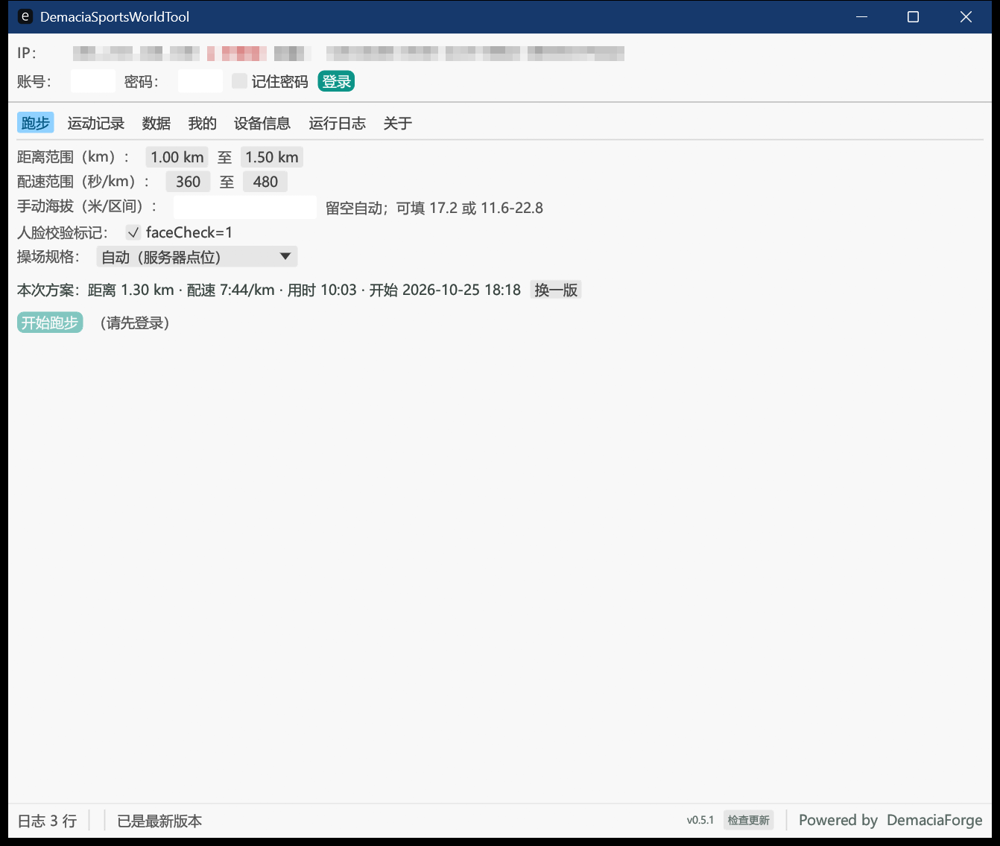

# DemaciaSportsWorldTool

运动世界校园版协议自动化工具。纯 Rust 单文件可执行程序，GUI / CLI 双模式。

> 本项目是 [NekoSportsWorldTool](https://github.com/YanamiNeko/NekoSportsWorldTool) 的衍生作品，
> 在原版基础上做了大幅精简与真实性改造。署名与许可证要求见文末。

改造依据与代码事实记录在 [docs/REALISM_FINDINGS_zh.md](docs/REALISM_FINDINGS_zh.md)。

## 界面



---

## 相对上游的主要改动

这一版做了**减法**：删掉三条维护成本高、收益低的生成路径，只留下能通过服务端交叉校验的那一条。

### 删除的功能

| 功能 | 删除原因 |
|---|---|
| **路网（Road）模式** | 自带一套速度剖面与字段逻辑、不走统一装配器，等于维护两份实现 |
| **AI 运动** | 与跑步记录无关的另一类记录，协议与校验完全不同 |
| **高德自定义路线** | 依赖外部路径服务，且自带距离/圈数换算 |
| **灰绿混合配色** | 灰绿分段在详情页会显示为灰色轨迹，反而可疑 |
| **自定义开始时间** | 原版可以把记录排到前 3 天；现固定为「现在 − 用时」 |
| **读取学校配速范围** | 改为人工填写，避免规则变更导致程序失效 |

连带的 `crates/route-planner`（1757 行）、`src/amap.rs`、`src/ui/map.rs` 一并移除。

### 新增与修正

- **围栏三级取值**：`策略内嵌 > 独立接口 > 点位缓存`。原实现只在策略没给围栏时才调独立接口，
  导致策略自带围栏的学校反而拿不到围栏来摆正跑道直道
- **普通点配额**：提交载荷保留至多 2 个点位的 `isFixed=0`，让「至少通过 2 个普通点位」达标。
  原实现把所有点标成必经点，那条规则在结构上不可能满足
- **真实性自检 19 项**：提交前对轨迹做互校，不通过直接中止
- **本地提交台账**：服务端只保留最近 10 条记录，台账记下每次成功的 `rrid` / `uuid` / 起跑时刻
- **`obs-real`**：拉回自己历史记录的 OBS 原始轨迹，用于对照字段
- **`--dry-run` 真正可用**：原版帮助里写了这个开关但从未接线

---

## 功能

- **跑步**：一键全链（策略 → 打卡点 → 轨迹 → 提交 → OBS → 验证）
  - 轨迹按打卡点用 Catmull-Rom 连成闭合环，**必然经过**每个打卡点
  - 可选标准跑道规格（自动 / 200 / 300 / 400 / 自定义长度），用电子围栏把直道摆正到场地长边
  - 路线颜色固定全绿色
- **数据**：学期完成度、违规自查、排行榜（个人 / 班级 / 院系 × 日 / 月、室内榜、历史榜）
- **登录**：人机验证本地自动通过，会话失效自动重登
- **自动更新**：检查 / 下载 / 自替换并重启；启动检查模式可选（静默 / 询问 / 关闭）。
  详见 [检查更新](#检查更新)

界面共 7 个标签页：跑步 · 运动记录 · 数据 · 我的 · 设备信息 · 运行日志 · 关于。

---

## 技术特点

- 完整实现 NetSecKit 信封加密与响应解密，每个响应强制 RSA 验签（fail-closed）
- 人机验证（GT4 滑块 + PoW）全程本地完成，不依赖外部服务
- **生物力学自洽**：`v = cadence/60 × stride`，速度、步频、步幅三者恒等；步频在目标值附近做
  OU 波动，步幅由速度反解，因此服务端做步频×步幅交叉校验时对得上
- 轨迹生成器：打卡点拟合环 + 自然速度曲线 + 哨兵点 / 断崖 / 点位吸附
- 设备身份持久化（DeviceId / 安装时间 / MAC），稳定不易触发风控
- GUI 与 CLI 共用同一套协议层，数据文件互通

### 提交前自检（19 项）

`src/track/realism.rs` 会对生成的轨迹做互校，任一项不过就中止提交：

| 维度 | 检查项 |
|---|---|
| 速度 | 瞬时速度峰值、速度字段与位移的相关性、速度字段量纲 |
| 时间 | 采样间隔（>30 s 判异常） |
| 距离 | 路径长 vs 声明距离、逐点 `totalDis` vs 位移重算 |
| 步态 | 步幅均值 / 标准差 / 包络（0.5–1.7 m）、速度与步频相关性 |
| 步数 | 累计步数、10 秒窗口步数 vs 总数 |
| 几何 | 环线圆度 |
| 分段 | 10 秒窗口、60 秒分段的总量守恒 |

---

## 使用

双击 exe 进入 GUI；CLI 用法：

```text
demaciasportsworldtool login --user <手机号> --pass <密码> [--remember]
demaciasportsworldtool logout
demaciasportsworldtool run                       # 一键跑步
demaciasportsworldtool run --dry-run --dist 2 --pace 420
                                                 # 本地生成并自检，不登录、不联网、不上传
demaciasportsworldtool run --altitude 17.2       # 固定海拔；或 11.6-22.8 映射到区间
demaciasportsworldtool records                   # 跑步记录列表
demaciasportsworldtool semester                  # 学期完成度
demaciasportsworldtool cheat [--page n]          # 违规自查
demaciasportsworldtool rank main --type 1 --sort 1
demaciasportsworldtool obs-real [--rrid n]       # 拉回真实 OBS 原始轨迹
demaciasportsworldtool ledger [--all] [--hint]   # 本地提交台账
demaciasportsworldtool template --file run.gpx   # 本地分析真实记录海拔（不会上传）
demaciasportsworldtool update [--check]
demaciasportsworldtool help                      # 全部命令
```

### 起跑时刻

固定为「现在 − 用时」。例如 14:40 提交一条 23 分钟的跑步，记录的就是 14:17–14:40。
**不支持**把记录排到过去的任意时刻。

### 手动海拔

三种状态：

- 留空 → 自动海拔
- 单个数字（如 `17.2`）→ 所有轨迹点使用固定海拔
- 区间（如 `11.6-22.8`）→ 把生成的海拔曲线映射到该区间，保留相对起伏

### 检查更新

界面**最下方**有「检查更新」按钮，右侧显示当前版本号。检查结果直接显示在左下角状态栏
（`已是最新版本` / `发现新版本 vX.Y.Z` / `检查更新失败…`）。

**启动时**也可自动检查，`config.json` 的 `update_check` 有三种取值：

| 值 | 行为 |
|---|---|
| `silent`（默认） | 静默检查，只有发现新版本才弹窗 |
| `ask` | 每次启动询问 |
| `off` | 完全不检查 |

更新源是 `api.github.com/repos/DemaciaForge/DemaciaSportsWorldTool/releases/latest`，
**匿名请求**，不携带账号令牌。因此本仓库必须保持 **public**，否则匿名读不到发布信息。

各平台对应的发布资产名是固定的，改名会导致更新失败：

| 平台 | 资产名 |
|---|---|
| Windows x86_64 | `DemaciaSportsWorldTool-win-x64.zip` |
| macOS arm64 | `DemaciaSportsWorldTool-macos-arm64.tar.gz` |
| Linux x86_64 | `DemaciaSportsWorldTool-linux-x64.tar.gz` |
| Linux aarch64 | `DemaciaSportsWorldTool-linux-aarch64.tar.gz` |

桌面端会从 zip 里找 `*.exe`（打包带 `target/` 路径也能识别），下载后自替换并重启。
网络不通时可到 [Releases](https://github.com/DemaciaForge/DemaciaSportsWorldTool/releases)
手动下载：退出程序，用新的 `demaciasportsworldtool.exe` 覆盖旧的，**保留**
`config.json`、`identity.json`、`points_cache.json` 等数据文件。

调试时可用环境变量 `NSWT_UPDATE_REPO` 临时指向别的仓库（如自己的测试 fork）。

### 青龙定时任务

首次手工 `login --remember` 一次，之后定时挂 `run` 即可。

---

## 数据文件

全部存放在**可执行文件同目录**：

| 文件 | 内容 | 能否删除 |
|---|---|---|
| `config.json` | 界面与参数配置（含勾选记住密码后的明文凭据） | 可删，会重置配置 |
| `identity.json` | 设备身份与定位锚点 | **不要删**，等于换新设备 |
| `session.json` | 登录会话 | 可删，需重新登录 |
| `points_cache.json` | 打卡点与围栏缓存 | 可删，会重新拉取 |
| `submitted_records.jsonl` | 本地提交台账 | 建议保留 |

---

## 常见问题

- **提示未登录 / 401**：先 `login --remember`，会话失效会自动重登
- **`10121` 设备风险**：设备身份是持久化的，删 `identity.json` 等于换了新设备，不要频繁删
- **`10603` 点位限流**：点位接口 5 分钟限 3 次，程序内置 300 秒缓存
- **提示「请先在设备信息页填写城市和定位锚点」**：默认锚点是大连，首次使用需在「设备信息」页
  填本校区坐标，否则拒绝提交
- **榜单为空**：当天还没有人产生有效里程，查询会自动回退最近 3 天
- **检查更新失败**：更新仅直连 GitHub，网络不通时到 Release 页手动下载
- **人机验证失败**：自动重试 3 轮，仍失败多为网络波动
- **杀软误报**：未签名编译产物可能被误报，自行判断后加白

---

## 构建

```bash
cargo build --release                         # GUI + CLI
cargo build --release --no-default-features   # 仅 CLI
```

**注意**：`--no-default-features` 会把 GUI 关掉，产物双击无参数只打印用法后立即退出。
要跑 CLI 调试又不覆盖 GUI 产物时，用独立 target 目录：

```bash
cargo build --no-default-features --target-dir target/cli
```

测试：

```bash
cargo test --workspace     # 144 项
```

推 tag 自动构建多平台产物并发布 Release（见 `.github/workflows/release.yml`）。

---

## 许可证与署名

本项目采用 [CC BY-NC 4.0](LICENSE)（**禁止商用**）。

它是 [NekoSportsWorldTool](https://github.com/YanamiNeko/NekoSportsWorldTool) 的衍生作品：

- 原作者：**YanamiNeko** © 2026
- 本衍生作品修改者：**DemaciaForge** © 2026

按 CC BY-NC 4.0 的署名要求，分发或再修改时需**同时保留上述两处署名**。
本衍生作品的改动集中在轨迹生成、协议载荷与真实性校验，详见提交历史。
